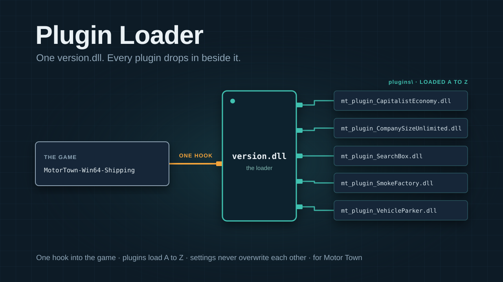

# Plugin Loader



**The loader every Motor Town plugin runs on. Install it once, then drop any plugin into the plugins folder beside it: plugins load in alphabetical order and never overwrite each other's settings.**

Motor Town has no built-in support for code mods. The Plugin Loader adds it: a single version.dll that the game loads on its own at startup, and that then loads every plugin you put in the plugins folder next to it. On its own it changes nothing you can see. It is what lets the plugins run.

### What you get

- One install for every plugin. Each plugin is a single file, plugins\mt_plugin_<Name>.dll, and the loader picks it up the next time you start the game.
- Plugins load in alphabetical order, the same order every time. Anything else in the plugins folder is ignored.
- One shared hook into the game, owned by the loader. Plugins go through it instead of each patching the game on their own, which is what lets several plugins run side by side without breaking each other.
- Settings that stay yours. Each plugin keeps its settings in plugins\<plugin>.ini, created on first launch. When two plugins share a settings file, each one only ever writes its own keys, and a value you typed by hand always wins over a plugin's default.

### Install

1. In Steam, right-click Motor Town > Manage > Browse local files.
2. Drag the MotorTown folder from this download into that window and let it merge.
3. Add the plugins you want the same way.

To remove it, delete MotorTown\Binaries\Win64\version.dll. To turn off one plugin, set Disabled=1 under [General] in its .ini file, or delete its .dll.

### Settings

The loader's own settings are in MotorTown\Binaries\Win64\mt_loader.ini, created on first launch.

- Logging=1 under [General] writes a log for the loader and every plugin, under plugins\logs. Logging is off by default, and then no log files are created.
- UnlockCheat under [CVars] is on by default. It lets the game take console variables that are normally locked to developers from your own ini files, which is what server and economy settings use. Set it to 0 to leave them locked.

### Linux and Steam Deck

Proton uses its own version.dll unless told otherwise. Add this to the game's Steam launch options:

```
WINEDLLOVERRIDES="version=n,b" %command%
```

### Antivirus warnings

Some scanners flag version.dll. It sits in the game folder under a Windows file's name and changes the running game, which is what a loader has to do and what a scanner is wary of. The loader makes no network connections, downloads nothing and runs no programs, and its full source is public. If yours flags it, exclude only the game's Binaries\Win64 folder. Do not turn your antivirus off.

### For mod makers

A plugin is a .dll that exports one function, PluginInit. It gets a versioned set of functions for reading the game, calling into it on the game thread, watching game functions, and reading and writing settings, documented in [include/mt_plugin_api.h](include/mt_plugin_api.h) and below. After a game update, Export=1 under [Mappings] in mt_loader.ini writes a fresh mappings file the next time you load a save.

---

## For plugin authors

Only one file can be `version.dll`, so this is it, and every native mod is a
plugin of it.

```
MotorTown\Binaries\Win64\version.dll                         the loader
MotorTown\Binaries\Win64\mt_loader.ini                       its settings: [General] Logging, [Mappings] Export, [CVars] UnlockCheat
MotorTown\Binaries\Win64\plugins\mt_plugin_<Name>.dll        a plugin
MotorTown\Binaries\Win64\plugins\<plugin>.ini                its settings, created on first launch
MotorTown\Binaries\Win64\plugins\logs\<Name>\<start>.log     a log, only with [General] Logging=1
```

Build: `build.bat` (MSVC 2022) -> `out\`. Proton: `WINEDLLOVERRIDES="version=n,b" %command%`.

- The ProcessEvent hook is installed as soon as the engine is ready -- **not**
  after the world comes up. ProcessEvent is the only way onto the game thread,
  so anything that needs the game before the first delivery exists (a key
  that opens a panel) waits for a world that may never arrive. The loader's
  log says `ProcessEvent: vtable index N, M slots hooked`; if that line is
  missing, nothing that touches the game thread runs.

## Rules

- Only `plugins\mt_plugin_*.dll` loads, in **alphabetical order** of file name
  (case-insensitive). Anything else in that folder is ignored.
- A plugin exports `int PluginInit(const MtApi*)` (`include/mt_plugin_api.h`),
  returns 0, and does its work on its own thread. A DLL without it is skipped
  without running: the loader checks the export with the file mapped but its
  DllMain not called, because loading and then freeing a DllMain-style DLL
  leaves its threads running in unmapped code -- that crashed the game once.
- **The loader owns everything invasive or shared.** The ProcessEvent hook is
  installed once, by the loader: a second hook on the same vtable slots finds
  them already swapped and breaks. Plugins get `run_on_game_thread` and
  `process_event` instead. Engine discovery (name pool, object table,
  UStruct/FField layout, FindObject, field offsets) also happens once, there.
- The api is a versioned struct of function pointers; fields are only appended,
  so a plugin built against v1 keeps working on later loaders.

## The api (v8)

`include/mt_plugin_api.h` is the whole contract. What a plugin gets:

| group | what |
|---|---|
| logging | `log(self, fmt, ...)` -- the plugin's own log file, one line per call |
| engine | `wait_engine`, `layout`, `read`, `write`, `name`, `fname`, `name_index`, `num_objects`, `object`, `find_object`, `is_a`, `field`, `field_offset` |
| the game thread | `run_on_game_thread(fn, ctx)`, `process_event(obj, func, parms)`, `game_thread_ready` |
| **watching** | `watch_functions(names, count, fn, ctx)` -- called back on the game thread when one of those UFunctions fires; `fn` may read **or edit** the parameter block in place, and returning non-zero blocks the original call |
| **patching** | `patch_bytes(addr, bytes, len)` -- overwrite game code (writable for the write, protection restored, instruction cache flushed) |
| **ini files** | `ini_set(self, file, section, key, value, force)` -- declare a value in one of the loader's ini files; `ini_get(file, section, key, buf, cap)` -- read the merged value back |
| names (v6) | `pool_names(fn, ctx)` -- walk every name the engine registered (console variables are registered by name) |
| keeping (v7) | `keep(obj)` -- keep an object for the session (AddToRoot), for assets a plugin loads and hands to the engine; since v7 `object()` returns 0 for an object the game destroyed but has not collected |
| closing (v8) | `stopping()` -- 1 once the loader decides the game is closing (the world is gone and none came back); a plugin's own threads end on it. While it is 1 the loader runs no plugin work. Not yet seen firing at a real exit: do not rely on it to save state |

Two things a plugin author needs to know, both learned the hard way:

- **The ProcessEvent hook does not see RPCs.** UE dispatches an RPC straight to
  the exec thunk. Blueprint events are visible (`ReceiveSetVehicle` fires on
  every vehicle swap); `ServerChangeVehicle` and `ServerBoughtVehicle` never
  fire, on either side. Anything that has to see an RPC needs `watch_functions`
  on the exec side, a native hook, or a code patch.
- `watch_functions` resolves each name to an FName index once and compares
  indices per call, so watching is cheap. Registering the same callback and ctx
  again is ignored; another callback on the same function is a separate watcher,
  so two plugins can watch one function. A name whose class is not loaded yet is
  simply not registered (retry). Watchers on one function run in registration
  order, and one that blocks the call also stops the ones after it.

## Ini files: the loader owns them

Plugins do not write `.ini` files themselves. They declare values and the
loader merges them, so two plugins that write the same file cannot overwrite
each other -- which is the whole point: `WritePrivateProfileString` rewrites
the file it is given, so two plugins doing that to the same file race, and the
loser takes the winner's file with it.

```c
// a default: the file's own value wins, so a hand-edited file is kept
iniSet(L"swim.ini", L"Swim", L"FloatDepth", L"60");
// live state: written through at once, always wins
iniSet(L"moretuning.ini", section, key, value, true);
// what the merged view says
std::wstring v = iniGet(L"swim.ini", L"Swim", L"FloatDepth");
```

`mt::iniNum` / `mt::iniInt` in `include/mt_plugin.hpp` do the declare-then-read
dance in one call, which is what most settings want.

The rules, in order of precedence:

- **a value already in the file wins** over a plugin's default. These files
  are edited by hand and what the user typed is kept;
- **two plugins declaring the same key**: the one that *loaded* first wins --
  not the one that declared first, since plugins declare on their own threads
  and that order is not fixed. The loser is refused and the conflict is
  logged, with both values;
- **a forced value** is written through at once and always wins. That is for
  live state, which must not wait for anything;
- only the keys a plugin declared are ever written, one key at a time, so the
  rest of the file -- other plugins' keys, the game's own keys, the comments
  in it -- is left exactly as it was.

A file name is a path relative to the game folder (`Binaries\Win64`), where
these files have always lived. `..` and absolute paths are refused.

`tools\ini_test.cpp` checks all of this without the game in the loop;
`build.bat` runs it.
